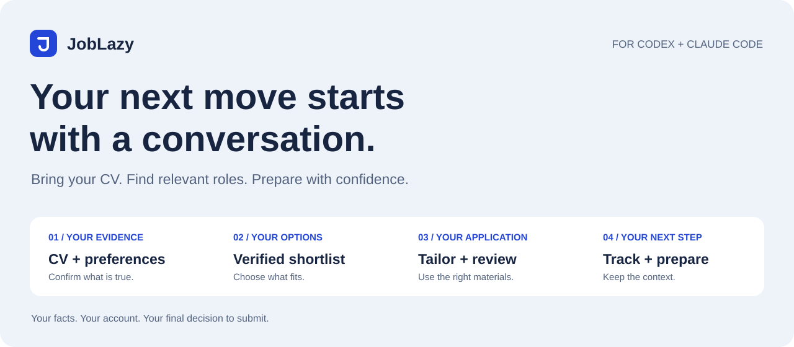
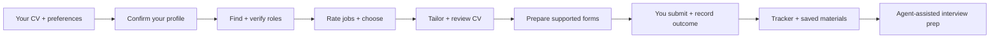
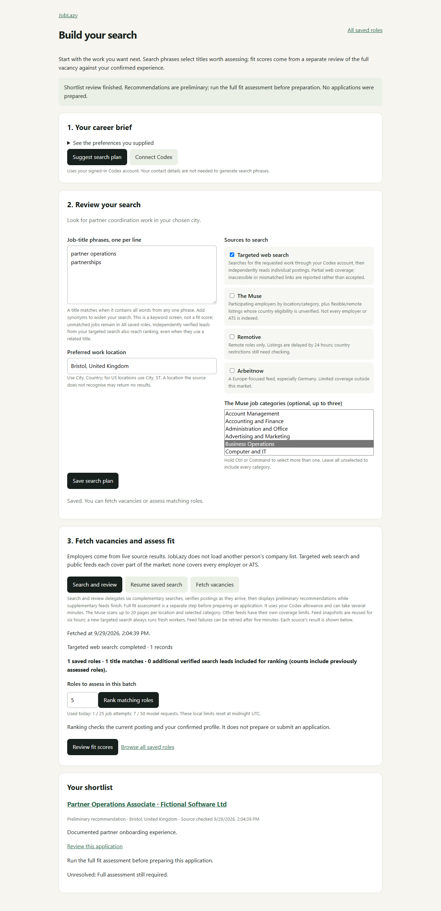
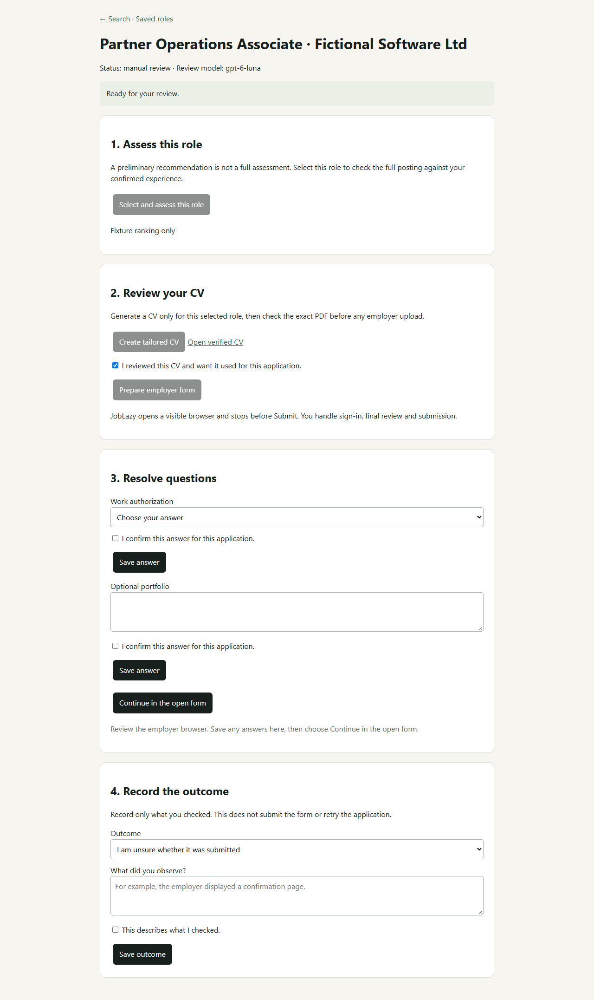

  

  <strong>A job-search workspace for Codex and Claude Code.</strong> 
  Bring your CV. Tell the agent what you want next. 
  Find and rate opportunities, then prepare tailored CVs and applications together.

  <a href="#start-in-three-steps">Get started</a> ·
  <a href="#job-ratings-decide-what-is-worth-your-time">Job ratings</a> ·
  <a href="#what-weve-actually-been-doing">Real use cases</a> ·
  <a href="docs/USE-CASES.md">Example conversations</a> ·
  <a href="docs/AGENT-VERIFICATION.md">What has been tested</a>

## What is JobLazy?

JobLazy brings the practical parts of a job search into one ongoing conversation: understanding your experience, finding relevant jobs, deciding which ones to pursue, making a truthful CV for each role, preparing supported application forms, and remembering what happened.

You talk to **Codex or Claude Code using your own account**. The agent handles the local tools. JobLazy keeps your confirmed profile, job records, CV versions and application history in a workspace on your computer, so the next conversation can pick up from saved work.

It grew out of a real job search. We kept needing more than a rewritten CV: the actual job description, a reason to apply, the right version of the document, the answers used on the form, and the context for a later interview. This project packages that workflow so someone else can start with their own experience.

**You review your facts and documents. You make the final employer submission.**

## Job ratings: decide what is worth your time

**The original Career Ops rating system is a core part of JobLazy.** A full job assessment gives you an **overall fit score out of 100**, a **Strong match / Worthwhile stretch / Poor fit** judgment, and the evidence behind it—before you spend time tailoring an application.

The same assessment includes five separate ratings, each **1–5** or **Unknown** when the evidence is missing:

| Rating | What it tells you |
| --- | --- |
| **CV fit** | How your confirmed experience matches the work and requirements. |
| **Career direction** | Whether the role moves you toward the work you actually want next—your North Star. |
| **Compensation** | How advertised pay compares with your saved expectations. Unadvertised pay stays unknown. |
| **Culture and working conditions** | What the posting says about working arrangements and your preferences. These are posting signals, not verified inside knowledge. |
| **Red flags** | Concerns supported by the posting. A higher rating means fewer observed concerns; it is not a guarantee that an employer is legitimate. |

Higher ratings are more favorable. **The overall score is a holistic judgment, not an average of the five ratings or a percentage chance of getting hired.** Each scored dimension needs posting evidence; CV fit and career direction also need candidate evidence. Unknown information is shown openly rather than given an invented neutral score.

Ask: **“Rate these jobs against my profile. Show the overall score, all five ratings, the strongest reasons, the gaps and any eligibility blockers.”** Chat should show the saved assessment, so you can compare opportunities and decide which to pursue.

The default selection cutoff is **70/100**, configurable in your profile. You can explicitly choose a worthwhile stretch below that cutoff. A high score or a decision to pursue does **not** bypass a known hard constraint or a Poor fit classification. Unverified eligibility stays uncertain; a blocked page or a role awaiting assessment does not get a made-up score.

Ratings and their supporting evidence are saved with the role. The tracker export includes the overall score and reason; the full five-dimension breakdown remains in the saved assessment/review. [See the assessment implementation](joblazy/materials.py) and [rating regression tests](tests/test_rubric.py).

## What a session looks like

These prompts illustrate the workflow; they are not a transcript or a claim of automatic results.

| You say | What happens | What you keep |
| --- | --- | --- |
| “Here's my CV. I want to move into commercial roles.” | Read the CV, surface missing details and confirm your experience, target work and location. | Your original CV and a separate confirmed profile. |
| “Find jobs that actually fit me.” | Search complementary sources, open employer postings, check relevance and remove duplicates. | Source links, saved job descriptions and a shortlist with reasons and gaps. |
| “Is this one worth applying for?” | Rate the full role against your evidence and preferences. | A score out of 100, five dimension ratings, fit category, reasons, gaps and eligibility status. |
| “Tailor my CV for this role.” | Select relevant confirmed experience, draft with the existing template and check claims and layout. | A role-specific PDF for you to review. |
| “Help me apply.” | Use the reviewed PDF and confirmed answers to prepare supported employer forms; ask about missing answers. | Prepared materials, a browser handoff and a record of what was actually done. |
| “What have I applied to, and what's next?” | Read saved job states and recorded outcomes; export the same tracker for Excel. | One opportunity history and a CSV snapshot. |
| “I've got an interview. What did I send them?” | Retrieve the exact saved application materials, then use the agent to prepare from that role and your evidence. | The relevant CV and an interview brief grounded in your application. |

## What we've actually been doing

The examples below come from earlier career-work sessions. They are anonymized: personal documents, employer receipts and private application records are not included in this repository. Some work used JobLazy's local tools; some used the accompanying agent and separate document tools. [The casebook explains the distinction.](docs/USE-CASES.md)

### Find and prepare the right opportunities

- **Search beyond one job board.** Combine target titles, adjacent responsibilities, employer sites and public ATS postings, then check the actual job description. Keep inaccessible leads separate from verified roles.
- **Rate jobs before investing in applications.** Use the original five-dimension rubric and overall score to compare opportunities, understand tradeoffs and choose a strong match or worthwhile stretch.
- **Make different CVs for different roles.** Prepare role-specific versions for commercial, partnerships, business-development and revenue-operations opportunities. Select relevant evidence instead of sending one generic document everywhere.
- **Revise a CV without losing the good parts.** Change a summary, emphasis or approved title while preserving the selected template, source facts and previous versions.
- **Prepare the application around the exact document.** Review the PDF, use that version for the form, and answer missing questions from confirmed information.

### Keep continuity after the application

- **Recover the CV actually used.** When several applications existed for one employer, identify the exact role and match its saved upload record and file hash. A similar filename was not enough.
- **Build a useful opportunity tracker.** Bring saved roles, fit reasons, latest events and outcome notes into one Excel-ready export. Distinguish prepared, submitted and uncertain outcomes.
- **Prepare for a Commercial Associate interview.** Start from the saved role and CV; build a 60-second introduction, company motivation, evidence-based stories, likely questions, a territory-plan outline and role-play prompts. Keep company research separate from claims about the candidate.

### Carry the work further with the agent

These are examples of the broader career workflow, **not dedicated JobLazy automation modules**. They require the relevant source material and document, research or communication tools in the host agent.

- **Company and territory research:** turn official sources into a sourced company brief, prospect research or an interview presentation, with evidence and gaps visible.
- **Warm outreach drafts:** refine an interview-advice message into a short, low-pressure request. Drafting a message does not send it.
- **Questionnaire completion:** fill a separate document copy from confirmed answers while preserving the original questions and business sections.
- **Evidence-backed portfolios:** turn documented past work into an editable case-study deck and shareable PDF, keeping completed work distinct from proposed ideas.

[**Explore all 12 use cases, example prompts and expected outputs →**](docs/USE-CASES.md)

## Start in three steps

### 1. Get a fresh copy

Download the current repository using **Code → Download ZIP**, or extract the current rc.3 handoff ZIP you were given. Use a new folder for your own job search.

Use the current main branch for chat mode. **The older rc.2 release download does not include chat mode.** See [current status](docs/STATUS.md) for version history.

### 2. Open the folder in Codex or Claude Code

Use an agent that can read the project and run local helper commands. Sign in with your own account. Chat mode uses that session; there is no second AI login or separate API key for JobLazy.

On Windows, the local helpers need **Python 3.12+, Node.js 22+, and Edge or Chrome**. The agent can check the setup and install project dependencies; missing system prerequisites still need installing. Web discovery requires working search/browser tools in your agent.

### 3. Paste this and bring your CV

> Use JobLazy in this chat. Read skills/joblazy/SKILL.md, check the setup, and help me get started with my own CV and job preferences.

Tell it what work you want, where you can work and what you want to avoid. It should help you confirm the important facts before creating a profile or tailoring applications.

Codex's skill entrypoint is `$joblazy`; Claude Code's is `/joblazy`. If your host does not discover the shortcut, the explicit prompt above points it to the same instructions.

[Chat setup and helper commands](docs/AGENT-QUICKSTART.md) · [Start Here](START%20HERE.txt)

## How the pieces fit together

The current chat supplies reasoning and available web tools. JobLazy's local code handles intake, structured assessments, claim checks, the established CV renderer, reviewed-file checkpoints, browser preparation and the SQLite opportunity tracker. Chat mode reuses these implementations through [the agent bridge](joblazy/agent.py).

Your originals and confirmed facts remain separate from generated drafts. A generated CV never becomes evidence for a new achievement. Private candidate data lives in ignored `local/` and `runtime/` folders and is excluded from the shareable source package. AI work uses the provider/account you are signed into; this is not an offline AI product.

## What's ready, and what needs your judgment?

**Current candidate: 0.1.0-rc.3.** The full suite passed **546 tests** from a clean Windows extraction. A real Codex chat-to-helper intake exchange also passed with a fictional CV. These establish local workflow behavior; they do not establish search quality or compatibility with every employer.

- **Claude Code:** the entrypoint and shared chat bridge are included; a live Claude Code session and a new user's PC/account have not been tested.
- **Applications:** supported form preparation is assisted. Final Submit and checked outcome recording remain human-controlled. A saved PDF, upload or local status is not proof of employer receipt.
- **Coverage:** source access, host tools, employer forms and account allowances vary. There is no guaranteed application count or hiring outcome.
- **Inbox and outreach:** automatic employer-email synchronization and automatic outreach are not shipped features. An earlier Gmail reconciliation attempt did not complete.

Read the [verification report](docs/AGENT-VERIFICATION.md) and [status, including the unresolved receipt-observation issue](docs/STATUS.md) for the precise evidence and limits.

## Prefer a dashboard?

There is also an optional local browser dashboard using its existing Codex backend. It has a separate [Windows setup guide](docs/WINDOWS-QUICKSTART.md). For the chat experience, follow the three steps above.

See the dashboard with fictional example data

These screenshots show the dashboard, not a Codex/Claude conversation or a live employer application.

| Search and shortlist | Review and preparation |
| --- | --- |
|  |  |

## Explore the project

| Guide | What it covers |
| --- | --- |
| [Use-case casebook](docs/USE-CASES.md) | Real workflow examples, prompts, outputs and boundaries. |
| [Feature inventory](docs/FEATURES.md) | Chat, dashboard and agent-assisted capabilities, with implementation links. |
| [Chat quickstart](docs/AGENT-QUICKSTART.md) | Setup and the commands the agent operates. |
| [Search](docs/SEARCH.md) · [Profile](docs/PROFILE.md) | Discovery sources, candidate facts and targeting. |
| [Operating guide](docs/OPERATIONS.md) · [Agent rules](docs/AGENT-RULES.md) | State, limits, evidence and runtime safeguards. |
| [Verification](docs/AGENT-VERIFICATION.md) · [Status](docs/STATUS.md) | Tested behavior and remaining limitations. |

Built with retained open-source components. See [LICENSE](LICENSE) and [third-party notices](THIRD_PARTY.md).
