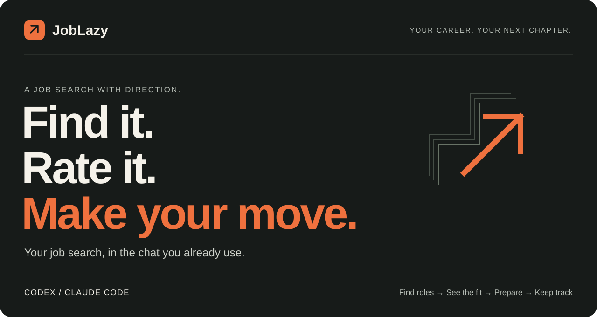
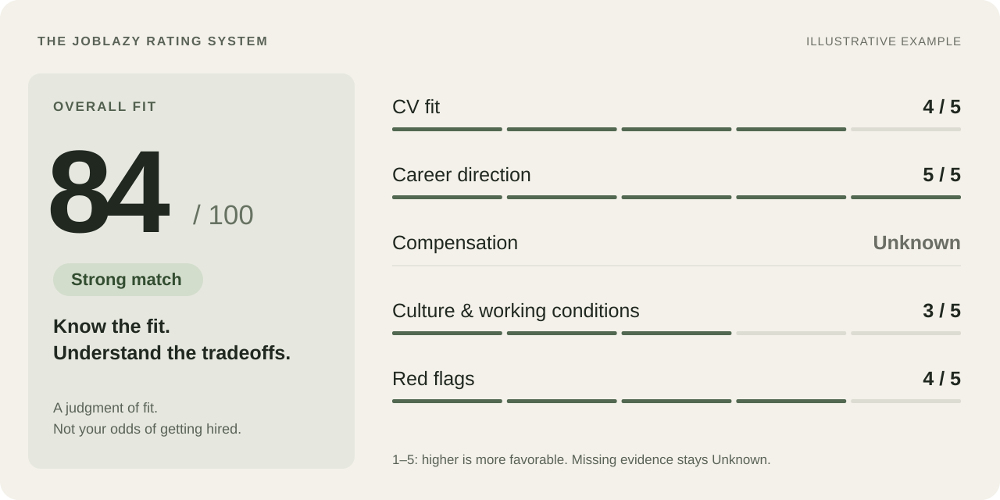

<picture>
  <source media="(max-width: 600px)" srcset="docs/media/hero-mobile.svg">
  
</picture>

<p align="center">
  <strong>A considered next move. A lot less job-search admin.</strong><br>
  Discover relevant roles, see how they rate, and prepare applications in the chat you already use.
</p>

<p align="center">
  <a href="https://github.com/Welzikl/JobLazy/releases/download/v0.1.0-rc.4/JobLazy-0.1.0-rc.4-windows.zip"><strong>Download for Windows ↗</strong></a>
  &nbsp; · &nbsp; <a href="#job-ratings-decide-what-is-worth-your-time">The rating system</a>
  &nbsp; · &nbsp; <a href="#what-weve-actually-been-doing">Real use cases</a>
  &nbsp; · &nbsp; <a href="#start-in-three-steps">Get started</a>
</p>

<p align="center"><sub>Early access · <a href="https://github.com/Welzikl/JobLazy/releases/tag/v0.1.0-rc.4">0.1.0-rc.4</a> · Your workspace. Your AI account.</sub></p>

<br>

## Your experience. Your direction. One workspace.

JobLazy turns the practical parts of a job search into an ongoing conversation with **Codex or Claude Code**. Bring your CV, confirm your facts, and describe the work you want next. The agent operates the tools; your workspace keeps the profile, opportunities, CV versions and application history.

It grew out of a real search: finding roles worth pursuing, making the right CV for each one, remembering exactly what was sent, and preparing for the interview that followed.

| Find your options | Know the fit | Make your next move |
| :--- | :--- | :--- |
| Search beyond one title or job board. Check the actual employer posting. | Compare the score, five ratings, evidence and gaps. Choose what matters to you. | Review a tailored CV, prepare supported forms and keep one opportunity tracker. |

**Your account. Your confirmed facts. Your final decision to submit.**

<br>

## Job ratings: decide what is worth your time

**The original Career Ops rating system is at the heart of JobLazy.** Every full assessment gives you a score out of **100**, a **Strong match / Worthwhile stretch / Poor fit** judgment, and five evidence-backed ratings.

<picture>
  <source media="(max-width: 600px)" srcset="docs/media/ratings-mobile.svg">
  
</picture>

<sub>Illustration of the assessment structure, not an app screenshot or a live vacancy. The overall score is holistic—not an average of the five ratings or a hiring probability.</sub>

> **“Rate these jobs against my profile. Show the scores, the reasons, the gaps and anything that would stop me applying.”**

**CV fit · Career direction · Compensation · Culture and working conditions · Red flags.** Each dimension is **1–5 or Unknown**. Chat shows the saved breakdown and its evidence, so you can compare opportunities before investing in an application.

<details>
<summary><strong>How the ratings work—and how they affect selection</strong></summary>

| Dimension | What it measures |
| --- | --- |
| **CV fit** | Your confirmed experience against the actual responsibilities and requirements. |
| **Career direction** | Alignment with the work you want next—your North Star. |
| **Compensation** | Advertised pay against your saved expectations. Unadvertised pay stays Unknown. |
| **Culture and working conditions** | Posting signals about working arrangements and your preferences; not verified inside knowledge. |
| **Red flags** | Concerns supported by the posting. A higher rating means fewer observed concerns, not a guarantee of legitimacy. |

Each scored dimension needs posting evidence. CV fit and career direction also need candidate evidence. Unknown information is never given an invented neutral score.

The default selection cutoff is **70/100**, configurable in your profile. You can explicitly pursue a worthwhile stretch below it. A high score or a decision to pursue cannot override a known hard constraint or a Poor fit classification. Unverified eligibility stays uncertain. Inaccessible or unassessed roles do not get a made-up score.

Ratings stay with the role. The tracker CSV includes the overall score and reason; the full breakdown stays in the assessment and review.

[Assessment implementation](joblazy/materials.py) · [Rating tests](tests/test_rubric.py)

</details>

<br>

## From “here's my CV” to “what's next?”

| Say it in chat | Keep something useful |
| --- | --- |
| **“Here's my CV. Help me get started.”** | Your preserved original, confirmed profile and job preferences. |
| **“Find and rate roles that fit me.”** | Verified posting links, saved descriptions, ratings, reasons and gaps. |
| **“Tailor this application.”** | A role-specific CV, checked against your evidence, for you to review. |
| **“Help me complete the form.”** | Supported fields and the exact reviewed CV prepared for your final check. |
| **“Show me where everything stands.”** | One opportunity history and an Excel-ready tracker snapshot. |
| **“I've got an interview. What did I send?”** | The exact saved application materials, with agent-assisted interview preparation. |

JobLazy keeps the context between stages. A generated CV stays a draft until reviewed; a prepared application stays distinct from a confirmed submission.

<br>

## What we've actually been doing

Twelve use cases from earlier career-work sessions, with example prompts and expected outputs. Personal documents, candidate details and employer receipts stay out of the repository.

| The application workflow | The work around it |
| :--- | :--- |
| **01** Confirm a profile from a CV<br>**02** Search broadly and rate roles<br>**03** Tailor separate CVs for different opportunities<br>**04** Revise a CV while preserving the template<br>**05** Prepare supported application forms<br>**06** Retrieve the exact CV used | **07** Consolidate opportunities and outcomes<br>**08** Prepare for the actual interview<br>**09** Research companies and territories<br>**10** Refine warm outreach drafts<br>**11** Complete a questionnaire copy<br>**12** Turn work evidence into a portfolio |

The local product handles intake, assessment, CVs, supported preparation and tracking. Exact-file retrieval, interview briefs, research, outreach drafts, questionnaires and portfolios use the accompanying agent and its available tools. They are not separate built-in automation modules.

**[Read the 12-case field guide →](docs/USE-CASES.md)**

<br>

## Start in three steps

### 01 — Make it yours

[**Download the Windows early-access package →**](https://github.com/Welzikl/JobLazy/releases/download/v0.1.0-rc.4/JobLazy-0.1.0-rc.4-windows.zip) and extract it into a fresh folder. You can also use GitHub **Code → Download ZIP** for the current source.

### 02 — Open your agent

Open the extracted folder in **Codex or Claude Code**, signed into your own account. Chat mode uses that session—no second AI login or separate JobLazy API key.

### 03 — Start the conversation

Copy this, then bring your CV and tell it what work you want next:

```text
Use JobLazy in this chat. Read skills/joblazy/SKILL.md,
check the setup, and help me get started with my own CV
and job preferences. Find and rate suitable roles,
then help me prepare the applications I choose.
```

**Windows prerequisites:** Python 3.12+, Node.js 22+, and Edge or Chrome. Your agent handles project setup and helper commands; missing system prerequisites need installing. Search and form preparation depend on the host's available web/browser tools.

<details>
<summary>Shortcuts, setup help and the optional dashboard</summary>

Codex's skill entrypoint is `$joblazy`; Claude Code's is `/joblazy`. If a shortcut is not discovered, the explicit prompt above points to the same instructions.

Use the [chat quickstart](docs/AGENT-QUICKSTART.md) for the current experience. `Setup.cmd` and `Start JobLazy.cmd` belong to the optional dashboard, which uses a separate Codex CLI backend. The older rc.2 download does not include chat mode.

[Start Here](START%20HERE.txt) · [Dashboard setup](docs/WINDOWS-QUICKSTART.md)

</details>

<br>

## Built around evidence. Honest about limits.

**Early access · 0.1.0-rc.4.** The release verification records the exact package checks. Earlier rc.3 verification passed **546 tests** from a clean Windows extraction and a fictional intake exchange with a real Codex chat. [Read the current release report →](docs/RELEASE-rc4.md)

You review facts, CVs and the final employer submission. Private profiles, documents and browser state stay in ignored local/runtime folders and are excluded from the source package. AI work uses your signed-in provider; it is not offline processing.

Live Claude Code operation and a new user's hardware/account remain untested. Employer coverage, search quality and account limits vary. Automatic submissions, inbox synchronization and automatic outreach are not provided. The [status page](docs/STATUS.md) also documents an unresolved receipt-observation issue; test counts do not establish hiring outcomes.

<details>
<summary>See the optional dashboard</summary>

These are actual dashboard screenshots with **fictional test data**. They are not the chat interface or live employer applications.


</details>

<br>

## Go a little deeper

| Start using it | Understand it | Inspect it |
| :--- | :--- | :--- |
| [Chat quickstart](docs/AGENT-QUICKSTART.md)<br>[Profile and preferences](docs/PROFILE.md)<br>[Search guide](docs/SEARCH.md) | [12 real use cases](docs/USE-CASES.md)<br>[Feature inventory](docs/FEATURES.md)<br>[Operating guide](docs/OPERATIONS.md) | [Release verification](docs/RELEASE-rc4.md)<br>[Agent rules](docs/AGENT-RULES.md)<br>[Implementation](joblazy/agent.py) |

---

<p align="center">
  <strong>JobLazy</strong><br>
  <sub>A little less admin. A more considered next move.</sub><br><br>
  <a href="LICENSE">MIT license</a> · <a href="THIRD_PARTY.md">Open-source credits</a> · <a href="docs/STATUS.md">Project status</a>
</p>
