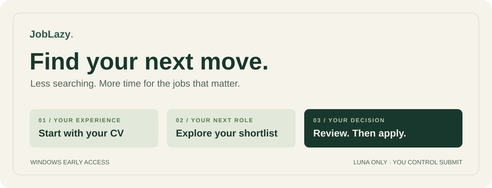

<p align="center">
  
</p>

<p align="center">
  <strong>Your job search, with a little less admin.</strong><br>
  Find roles, prepare a tailored CV, and get help filling application forms.<br>
  You review the details and decide when to press Submit.
</p>

<p align="center">
  <a href="https://github.com/Welzikl/JobLazy/releases/download/v0.1.0-rc.2/JobLazy-0.1.0-rc.2-windows.zip"><strong>⬇ Download for Windows</strong></a>
  &nbsp; · &nbsp;
  <a href="docs/WINDOWS-QUICKSTART.md">Setup guide</a>
  &nbsp; · &nbsp;
  <a href="https://github.com/Welzikl/JobLazy/releases/tag/v0.1.0-rc.2">Release notes</a>
</p>

> **Early access · v0.1.0-rc.2**<br>
> Uses **GPT-6 Luna throughout** with your own Codex account. No Astra needed. This is a working test version: expect rough edges and check every CV and application.

## What can it help with?

| You want to… | JobLazy helps you… |
| --- | --- |
| Find a starting point | Upload your CV, correct your details, and describe the work you want next. |
| Spend less time searching | Run six complementary searches, check job links, and remove duplicates. |
| Decide which roles are worth a look | See a shortlist, then assess a selected job against your confirmed experience. |
| Prepare your application | Make a tailored CV for you to check, then help fill supported employer forms. |
| Remember what happened | Save answers, record application outcomes, and download your tracker. |

## Start here — Windows

**First time?** Accept your GitHub invitation and sign in before downloading. A 404 page usually means you are signed out or have not accepted access yet.

### 1. Get the essentials

You need **Python 3.12+**, **Node.js 22+**, **Edge or Chrome**, and **Codex signed in to your own account**. The [setup guide](docs/WINDOWS-QUICKSTART.md) explains the checks and common fixes. Your account must have access to Luna.

### 2. Download and unpack

[**Download JobLazy for Windows →**](https://github.com/Welzikl/JobLazy/releases/download/v0.1.0-rc.2/JobLazy-0.1.0-rc.2-windows.zip)

Right-click the ZIP → **Extract All**. Open the extracted folder. Choose the file named **JobLazy-0.1.0-rc.2-windows.zip**, rather than GitHub's separate “Source code” downloads.

### 3. Set up once, then open

Double-click **Setup.cmd** and follow its messages. When it finishes, double-click **Start JobLazy.cmd**. JobLazy opens in your browser; keep the small launcher window open while you use it.

### 4. Make it yours

Upload your CV, check the extracted details, and tell JobLazy what you want next. Start a search, choose a role, and review its assessment and tailored CV before preparing the employer form.

**No coding is needed for the normal workflow.** You will see command windows during setup and launch. JobLazy runs on your PC and needs an internet connection.

## Take a look

These are screenshots of the real interface using **fictional test data**. They show the workflow; they are not a promise of the jobs or results you will receive.

<table>
<tr>
<th width="50%">Build your search</th>
<th width="50%">Review your application</th>
</tr>
<tr>
<td valign="top">Choose the work and location you want. Check the search plan, then explore your shortlist.</td>
<td valign="top">Check your CV, answer missing questions, and continue in the open employer form.</td>
</tr>
<tr>
<td valign="top"><a href="docs/screenshots/search.png"></a></td>
<td valign="top"><a href="docs/screenshots/application.png"></a></td>
</tr>
</table>

## Will it work with my usual Codex subscription?

JobLazy uses **your own Codex sign-in**. There is no separate API key to enter and no Astra dependency. Your subscription's actual model access and usage allowance still apply; a £20 subscription does not guarantee a particular number of applications.

To keep usage down, JobLazy reuses saved work, uses Luna for AI tasks, and uses ordinary code for job feeds, duplicate removal, PDFs and tracking. Each new web search runs six short search missions, with up to three running together. Reopening saved results does not start another search.

The app stops at **25 processing attempts** or **50 new AI request reservations per UTC day**. One application can need several attempts and requests, so **25 is a safety ceiling, not 25 promised applications**. It will stop if your account runs out of allowance; it will not switch models or buy credits.

[More about usage and limits →](docs/ECONOMICAL-USAGE.md)

## You stay in control

- **Your facts:** correct your profile and review every generated CV. AI wording can be wrong.
- **Your application:** supported fields can be prepared, but final Submit is yours. Check the employer's form yourself.
- **Your records:** your CV, answers and history are saved in local folders on your PC. Relevant text goes through your Codex account for AI tasks, and job searches and forms contact external sites.
- **Your privacy:** nobody else's profile or account is included in the download. Keep your private data folders and raw logs out of GitHub issues.

Email replies and LinkedIn outreach are planned for later. Some employer forms will need manual work. Image-only scanned CVs need a text-readable copy.

## What has been checked?

**539 automated tests passed** from the exact Windows release ZIP. Setup and launch worked from a clean extraction on an existing Windows development PC. The full application journey was tested with fictional data and a local employer form; nothing was submitted.

A separate live Luna trial completed CV intake, search, assessment and CV generation. Search and review took about **86 seconds**, but produced only **one stretch recommendation** from three verified postings. That small sample does not establish broad search quality, form reliability or performance on your account.

The ZIP was downloaded back from GitHub and its SHA-256 matched the tested file. Remote CI status is shown in [GitHub Actions](https://github.com/Welzikl/JobLazy/actions); the local result above is separate.

[Verification details](docs/STATUS.md) · [Full feature list](docs/FEATURES.md) · [Release evidence](https://github.com/Welzikl/JobLazy/releases/tag/v0.1.0-rc.2)

## Something not working?

Start with the [Windows help guide](docs/WINDOWS-QUICKSTART.md#if-something-stops). To report a problem, [open a bug report](https://github.com/Welzikl/JobLazy/issues/new?template=bug_report.md) with the step you reached, what you expected, and what happened. Remove personal information from screenshots first.

<details>
<summary><strong>For developers and existing personal-preset users</strong></summary>

The Windows launcher selects the friend preset. Plain `dashboard` retains the personal preset: Luna search, Astra review/assessment and Terra intake/preparation. Selecting the friend preset does not migrate or replace existing personal data.

```powershell
.\.venv\Scripts\python.exe -m joblazy dashboard --preset friend --browser-channel msedge
```

Run checks in a disposable source-only copy:

```powershell
.\.venv\Scripts\python.exe scripts\verify-vendor.py
.\.venv\Scripts\python.exe -m unittest discover -s tests -t . -v
```

Run `python scripts/check-public.py --source-tree` on a clean extraction before setup, or `python scripts/check-public.py` in a Git checkout. Some browser tests require Chrome. The connected friend journey also supports Edge via `JOBLAZY_TEST_BROWSER_CHANNEL=msedge`.

[Operations](docs/OPERATIONS.md) · [Profile setup](docs/PROFILE.md) · [Search behavior](docs/SEARCH.md)

This Python app runs locally. GitHub hosts its documentation and downloads; GitHub Pages does not run its backend.

</details>

---

[MIT License](LICENSE) · [Third-party acknowledgements](THIRD_PARTY.md)
